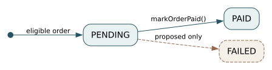

# Order state model

Solid arrows represent service behavior verified in MongoDB. The dashed arrow represents an unimplemented failure path. The HTTP API creates PENDING orders and lists a buyer's orders. The internal markOrderPaid method sets an existing order to PAID. The enum declares FAILED, with no implemented failure handler. The current service assigns PAID without a prior-state guard or provider verification. Neither a rollback operation nor a recovery policy is exposed. Release requirements for those paths remain open.

| ID | Design and expected behavior | Result |
|---|---|---|
| ST-01 | Eligible first purchase starts PENDING | PASS, API-13 and IT-07 |
| ST-02 | Confirmed provider outcome transitions PENDING to PAID | BLOCKED at provider boundary. IT-07 passed for the internal method |
| ST-03 | Failed provider outcome sets FAILED under an approved policy | BLOCKED, no failure handler |
| ST-04 | Unauthorized PAID rollback should preserve PAID | BLOCKED, no transition endpoint or rollback operation |
| ST-05 | Unauthorized FAILED recovery should be rejected | BLOCKED, no recovery policy or exposed handler |
| ST-06 | Repeat purchase is denied | PASS, API-14. It returns 409 |
| ST-07 | PENDING order preserves premium-content lock | PASS, IT-07. Paid order unlocks the recipe |

## Use case and extension

1. Sign in as BUYER and retrieve a premium recipe preview.
2. Request an order for that recipe and verify that the response and persisted order say PENDING.
3. Reopen premium details and verify that the pending order has not unlocked them.
4. Extension: submit the same purchase again, expect HTTP 409 and preserve the existing order.

API-11/13/14/15 and IT-07 provide evidence for these observations.

## Exploratory charter

Mission: investigate when the preview becomes full content, when a repeating request is refused, and which payment state paths the current UI and API allow. Timebox: 20 minutes. Zone: isolated buyer, premium fixture, order list and source-defined transition points. Record the starting state, action, returned status and follow-up recipe access. Priority is high for pending and paid access and provider failure. Evidence is available through the mapped automation and source review. A separate unscripted session was not executed.
